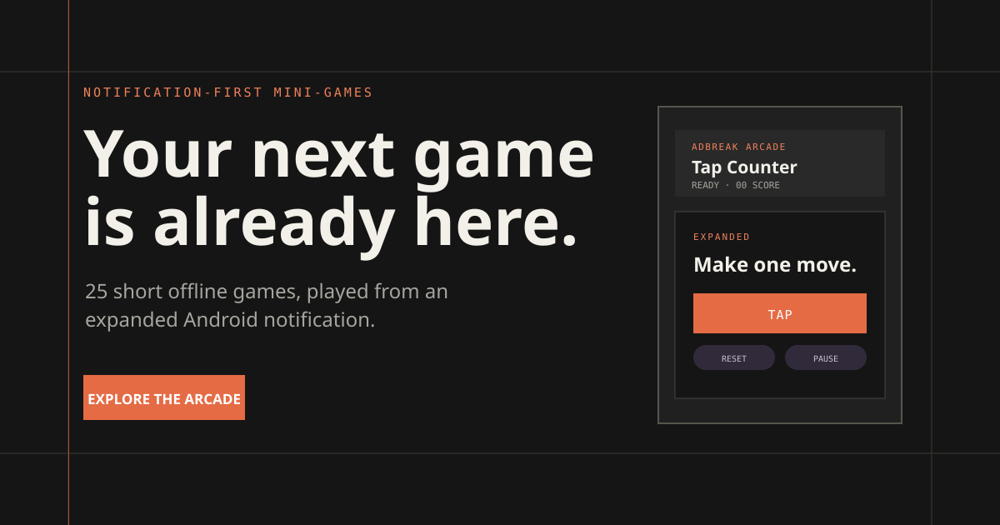
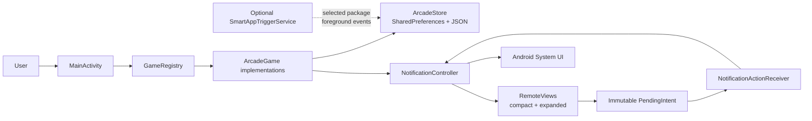

<div align="center">

# AdBreak Arcade

### Small games. Right where your notifications live.

25 lightweight offline Android games that run from an expanded notification
while another app remains in the foreground.

[](https://github.com/rakshit-737/adbreak-arcade/actions/workflows/android.yml)
[](https://github.com/rakshit-737/adbreak-arcade/actions/workflows/deploy-pages.yml)
[](https://github.com/rakshit-737/adbreak-arcade/releases)
[](LICENSE)

<br />

<a href="https://rakshit-737.github.io/adbreak-arcade/">
  
</a>

<br />

<a href="https://rakshit-737.github.io/adbreak-arcade/">Visit the product website</a> ·
<a href="https://github.com/rakshit-737/adbreak-arcade/releases/tag/v1.6.0">Download the testing release</a>

</div>

> The image above is conceptual product artwork. It is not an OEM Android
> screenshot and does not claim that every device renders notifications this
> way.

## What it is

AdBreak Arcade is a native Kotlin Android app for short, notification-first
play:

1. Open the app and choose a game.
2. Start its notification.
3. Switch back to another app.
4. Expand the Android notification shade.
5. Make moves using the visible notification controls.

The app does **not** detect, identify, skip, click, block, or manipulate
advertisements. The name describes the moment it is designed for, not an ad
blocking capability.

## Highlights

- **25 playable games** covering action, logic, word, number, board, and
  campaign-style mechanics.
- **Notification-native controls** rendered with Android `RemoteViews` in
  compact and expanded layouts.
- **Offline-first state** stored locally with `SharedPreferences` and versioned
  JSON game snapshots.
- **Local progression** including XP, levels, recent games, favourites, play
  counts, completion counts, and personal records.
- **Session-safe actions** using immutable `PendingIntent` envelopes with game,
  session, and render-revision checks.
- **Optional Smart App Triggers**, disabled by default and based on selected
  apps' foreground transitions plus Android Usage access.
- **Native Android UI** built with Kotlin, Android Views/XML, AndroidX, and
  Material components.
- **Interactive product website** built with React, TypeScript, Vite, and
  Vitest, including a browser arcade and notification simulation.

## Game catalogue

The Android source of truth is [`GameRegistry.kt`](app/src/main/java/com/adbreak/arcade/core/GameRegistry.kt).
The 25 registered games are grouped below for browsing; grouping does not gate
access or change the game rules.

### Action and survival

`Tap Counter` · `Rock Paper Scissors` · `Pocket Dungeon` · `Starship Survival`

### Logic, numbers, and code

`Quick Math` · `Higher or Lower` · `Memory Challenge` · `Number Sequence` ·
`Odd One Out` · `Mastermind Mini` · `Guess the Pattern` · `Cyber Heist` ·
`Cipher Vault` · `Pulse Reactor`

### Words and knowledge

`Word Scramble` · `Emoji Decode` · `Trivia Blitz` · `Anagram Challenge`

### Boards, grids, and tactics

`Tic-Tac-Toe` · `Nim` · `Connect Three` · `Lights Out Mini` · `Neon Tactics` ·
`Prism Protocol` · `Micro Tower Command`

## Visual walkthrough

The repository currently contains product artwork and the live website, but no
captured Android device screenshots. That distinction matters because Android
System UI, notification sizing, OEM decoration, and media behavior vary by
device.

| Experience | Current asset or status |
| --- | --- |
| Product overview | [Conceptual notification artwork](website/public/og-image.svg) |
| Website interaction | [Live product website](https://rakshit-737.github.io/adbreak-arcade/) |
| Android launcher | Capture on a real API 26/API 33+/API 35–36 device or emulator |
| Expanded notification | Capture compact and expanded System UI states on supported devices |
| Smart App Triggers | Capture Settings → Configure Smart App Triggers after granting Usage access |
| Privacy and settings | Capture notification permission, theme, local data, and trigger states |

Do not treat the conceptual artwork as evidence of an OEM layout. Device
screenshots are the remaining documentation asset for a complete visual QA
gallery.

## Architecture

The Android app keeps game rules, persistence, notification rendering, and
Activity UI separate:



### Important Android components

- [`MainActivity`](app/src/main/java/com/adbreak/arcade/ui/MainActivity.kt)
  provides Home, Library, Scores, Settings, About, onboarding, theme selection,
  and Smart App Trigger configuration.
- [`GameRegistry`](app/src/main/java/com/adbreak/arcade/core/GameRegistry.kt)
  creates fresh `ArcadeGame` instances for the 25 registered IDs.
- [`ArcadeGame`](app/src/main/java/com/adbreak/arcade/core/GameAction.kt)
  defines the renderable `GameViewState`, discrete actions, phases, progress,
  records, and disabled-action explanations.
- [`ArcadeStore`](app/src/main/java/com/adbreak/arcade/data/ArcadeStore.kt)
  persists selected games, active sessions, game state, stats, records,
  favourites, recent games, onboarding, theme preference, and progression.
- [`NotificationController`](app/src/main/java/com/adbreak/arcade/notification/NotificationController.kt)
  creates the low-importance channel, builds `NotificationCompat` notifications,
  renders `RemoteViews`, and posts the stable notification.
- [`NotificationActionReceiver`](app/src/main/java/com/adbreak/arcade/notification/NotificationActionReceiver.kt)
  receives immutable notification actions and hands them back to the controller.
- [`SmartAppTriggerService`](app/src/main/java/com/adbreak/arcade/trigger/SmartAppTriggerService.kt)
  discovers launchable apps, stores selected package names locally, and polls
  Usage Events on an integration-owned lifecycle callback.

## How notification gameplay works

The notification channel is low importance, silent, ongoing, and uses a stable
notification ID. The compact view prioritizes title, phase, score, and a short
objective. The expanded view exposes game-specific controls, feedback, progress,
and accessible content descriptions.

Actions are rejected when they are stale, addressed to another game/session, or
use an old render revision. Paused, terminal, board, large-font, and menu states
are rendered explicitly rather than relying on hidden Activity state.

Android still owns notification sizing, decoration, shade dismissal, and media
focus. The app intentionally uses `RemoteViews` instead of a WebView, Canvas,
Unity, overlay, accessibility service, or notification listener.

## Smart App Triggers

Smart App Triggers are a separate, opt-in capability:

- Disabled by default.
- Configured from **Settings → Configure Smart App Triggers**.
- Requires Android **Usage access**.
- Lets the user select launchable applications and a game/cooldown.
- Observes only selected package foreground transitions.
- Stores selected package names and polling/duplicate history locally.
- Uses best-effort lifecycle polling; it is not a continuously active watcher.

The feature does not inspect another app's screen, text, video, or ads. It does
not force the notification shade open and does not promise an immediate trigger
for every foreground transition. OEM background restrictions can delay or
prevent a poll.

## Privacy and permissions

The manifest declares two permissions:

- `POST_NOTIFICATIONS` for Android 13/API 33+ notification gameplay.
- `PACKAGE_USAGE_STATS` for the optional Smart App Trigger feature.

The app does not declare network access and has no account, cloud sync, backend,
analytics, advertising SDK, contacts, location, camera, microphone,
accessibility-service, overlay, or notification-listener permission in its
manifest. Local game state and preferences remain on the device. AndroidX and
Material dependencies are used for the native app; the app module contains no
analytics or advertising dependency.

## Releases and installation

The current published release is **v1.6.0**, a GitHub **prerelease for
testing**:

- [Release page](https://github.com/rakshit-737/adbreak-arcade/releases/tag/v1.6.0)
- [Debug APK](https://github.com/rakshit-737/adbreak-arcade/releases/download/v1.6.0/adbreak-arcade-v1.6.0-debug.apk)
- [Unsigned release APK](https://github.com/rakshit-737/adbreak-arcade/releases/download/v1.6.0/adbreak-arcade-v1.6.0-release-unsigned.apk)
- [SHA-256 checksums](https://github.com/rakshit-737/adbreak-arcade/releases/download/v1.6.0/SHA256SUMS.txt)

The debug APK is installable for device testing and is signed with the standard
Android debug key. The release APK is minified, resource-shrunk, and **unsigned**;
it is not a production distribution. Production signing is intentionally not
stored in this repository.

### Install the debug build with `adb`

1. Download the debug APK from the release page.
2. Enable Developer options and USB debugging on the device.
3. Connect the device and authorize the computer.
4. Confirm the device:

   ```bash
   adb devices
   ```

5. Install or update the app:

   ```bash
   adb install -r adbreak-arcade-v1.6.0-debug.apk
   ```

On Android 13/API 33 and newer, allow notification permission before starting a
notification game. The app remains browseable if notification permission is
denied, but notification-native gameplay is unavailable until the permission and
channel are enabled.

## Developer setup

### Android prerequisites

- Android Studio or the Android SDK command-line tools.
- JDK 17 for the CI toolchain.
- Gradle wrapper 9.6.0.
- Android Gradle Plugin 9.5.0.
- Compile SDK 36 and target SDK 36.
- Minimum SDK/API 26.
- SDK packages `platforms;android-36`, `build-tools;36.0.0`, and
  `platform-tools`.

If Android Studio does not create it, add a machine-specific `local.properties`
file at the repository root. Do not commit it:

```properties
# Windows example
sdk.dir=D\:\\Android\\Sdk
```

### Build and test the Android app

From the repository root:

```bash
./gradlew testDebugUnitTest
./gradlew lintDebug
./gradlew check
./gradlew assembleDebug
```

The installable debug APK is written to:

```text
app/build/outputs/apk/debug/app-debug.apk
```

For the broader CI-style validation pass:

```bash
./gradlew check lintDebug lintRelease assembleDebug assembleRelease bundleRelease
```

On Windows, use `gradlew.bat` instead of `./gradlew`. A connected device or
emulator is required for instrumentation tests:

```bash
./gradlew connectedDebugAndroidTest
```

### Run the website

The website is a separate Vite project in `website/` and uses
`/adbreak-arcade/` as its production base path.

```bash
cd website
npm ci
npm run dev
```

Production checks:

```bash
npm run typecheck
npm test
npm run build
```

The published site is <https://rakshit-737.github.io/adbreak-arcade/>. GitHub
Pages deployment is defined in
[`.github/workflows/deploy-pages.yml`](.github/workflows/deploy-pages.yml) and
runs on changes under `website/` on `main`.

## Testing status

### Automated verification

- Android JVM tests cover game legality, invalid and terminal actions, replay,
  scoring, generation, persistence, notification presentation, and Smart App
  Trigger guards.
- `app/src/androidTest` contains a notification-channel instrumentation smoke
  test.
- The website has reducer tests for the notification demo and eight browser
  cabinet games. The current website suite contains 9 tests.
- GitHub Actions runs Android checks on pushes to `main` and pull requests,
  validates website typecheck/tests/build before GitHub Pages deployment, and
  builds release artifacts for version tags.

### Manual device testing still required

This workspace does not have a connected Android emulator or physical device.
The following are therefore not represented as completed local checks:

- Fresh install and notification permission behavior on API 33+.
- OEM compact/expanded layouts on API 26, API 33+, API 35, and API 36.
- Dark mode, large font scale, TalkBack, and navigation mode behavior.
- Notification actions during process recreation and media playback.
- Smart App Trigger timing under OEM background restrictions.

## Project structure

```text
.
├── app/
│   ├── src/main/java/com/adbreak/arcade/
│   │   ├── core/          # ArcadeGame implementations and GameRegistry
│   │   ├── data/          # Local persistence, stats, and records
│   │   ├── notification/  # NotificationCompat, RemoteViews, and receiver
│   │   ├── trigger/       # Optional Usage Access trigger flow
│   │   └── ui/            # MainActivity and game presentation catalog
│   ├── src/main/res/      # Activity and notification XML/resources
│   ├── src/test/          # JVM game, persistence, notification, and trigger tests
│   └── src/androidTest/   # Device/emulator smoke tests
├── website/
│   ├── src/               # React application, cabinet logic, and components
│   ├── public/            # Favicon and conceptual Open Graph artwork
│   ├── package.json       # Vite, TypeScript, React, and Vitest scripts
│   └── vite.config.ts     # GitHub Pages base path: /adbreak-arcade/
├── reports/               # Gameplay and notification QA evidence
├── .github/workflows/     # Android CI, Pages deployment, and release workflow
├── DESIGN.md              # Product and visual system decisions
├── CONTRIBUTING.md        # Contribution workflow and constraints
├── SECURITY.md            # Private vulnerability-reporting guidance
└── LICENSE                # Apache License 2.0
```

## Project status and roadmap

### Implemented

- 25 offline Android games with local state restoration.
- Notification-first game controls with compact and expanded `RemoteViews`.
- Search, family filtering, favourites, recent games, XP, records, and themes.
- Optional Smart App Triggers with explicit configuration and Usage access.
- React/Vite website with a searchable catalogue, browser arcade, notification
  simulator, responsive layout, and light/dark themes.
- Android CI, GitHub Pages deployment, tagged testing-release automation, and
  checksum publication.

### In progress

- Device and OEM validation for notification rendering, font scaling, TalkBack,
  media behavior, and Smart App Trigger timing.
- Capture Android screenshots for the repository documentation gallery.

### Not currently supported

- Production-signed APKs or Play Store distribution.
- Accounts, cloud sync, backend services, analytics, advertising SDKs, network
  features, ad detection, ad blocking, overlays, accessibility services, and
  notification listeners.

There is no committed feature roadmap beyond compatibility and documentation
follow-up. New proposals should be discussed in an issue before implementation.

## Contributing

See [CONTRIBUTING.md](CONTRIBUTING.md) and the [Code of Conduct](CODE_OF_CONDUCT.md).
The short version:

```bash
git clone https://github.com/rakshit-737/adbreak-arcade.git
cd adbreak-arcade
git switch -c feat/short-description
```

Keep changes focused, preserve the `ArcadeGame`/`GameRegistry` architecture,
respect `RemoteViews` limits, and add tests for new rules, persistence, malformed
state, notification actions, and important boundaries. UI changes should be
checked for accessibility, large text, dark mode, and touch targets. Do not add
credentials, signing keys, generated output, account systems, analytics,
advertising SDKs, or network dependencies.

Before opening a pull request, run the narrowest relevant checks and review:

```bash
git diff --check
./gradlew testDebugUnitTest lintDebug check assembleDebug
cd website && npm ci && npm run typecheck && npm test && npm run build
```

## License and security

AdBreak Arcade is released under the [Apache License 2.0](LICENSE).

Please do not report security vulnerabilities in a public issue or pull request.
Follow [SECURITY.md](SECURITY.md) for private reporting guidance. Do not treat
the debug testing APK as a production distribution channel.

## Related documentation

- [Design system and product constraints](DESIGN.md)
- [Gameplay polish report](reports/GAMEPLAY_POLISH.md)
- [Notification QA notes](reports/notification-polish-qa.md)
- [Contribution guide](CONTRIBUTING.md)
- [Security policy](SECURITY.md)
- [Testing release v1.6.0](https://github.com/rakshit-737/adbreak-arcade/releases/tag/v1.6.0)
